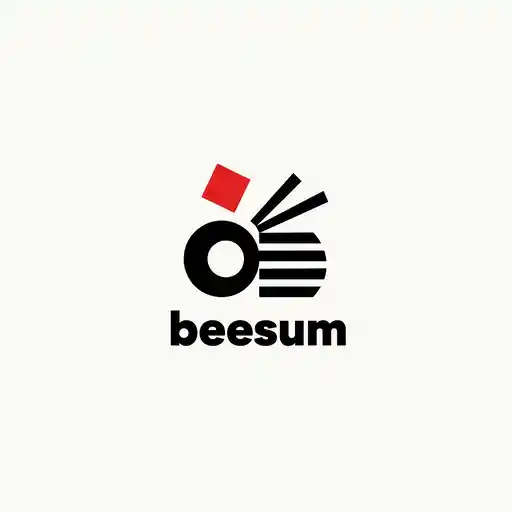
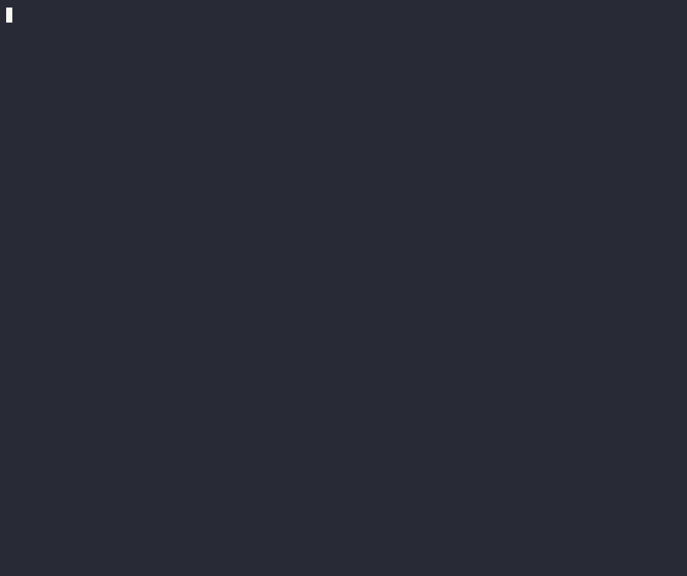

# beesum-min



**Transcript-first YouTube summarizer for the terminal: yt-dlp + WebVTT + local or API LLMs.**

[](https://github.com/air-catfish/beesum-min/actions/workflows/ci.yml)
[](LICENSE)

Downloads YouTube subtitles with yt-dlp, parses WebVTT, and prints a clean
transcript or a summary. `transcript-only` is the default: it never sends the
transcript anywhere. Ollama stays local; cloud providers are opt-in.



## Install

```bash
dotnet tool install -g beesum-min
```

## Run

Local sample, no network:

```bash
beesum-min --local-vtt samples/demo/smoke.vtt --timestamps
```

```text
[00:00:00] Hello world
[00:00:02] This is a smoke test.
```

A real video:

```bash
beesum-min "https://www.youtube.com/watch?v=..." --json
```

`--from/--to`, `--save-vtt`, `--save-transcript`, `--prompt-file`,
`--instructions`, `--sub-langs`, `--timestamps`, `--format mindmap`,
`--stdin`, `--batch`, `--proxy` — see `--help`.

Check the local setup:

```bash
beesum-min doctor
```

## Source

```bash
dotnet build beesum-min.slnx -c Release
dotnet run --project src/Beesum.Min.Cli -- --local-vtt samples/demo/talk.vtt
```

## Docs

- [Docs site](https://air-catfish.codeberg.page/beesum-min/) (after the `pages` branch is published)
- [Install](docs/install.md) · [CLI](docs/cli.md) · [Library](docs/embedding.md)
- [MCP](docs/mcp.md) · [Editors](docs/editors.md) · [Testing](docs/testing.md)

## Disclaimer

The tool uses `yt-dlp` to download subtitles. You are responsible for complying
with YouTube's terms and with the rights of the content you process.

## License

MIT. Report security issues through GitHub advisories.
